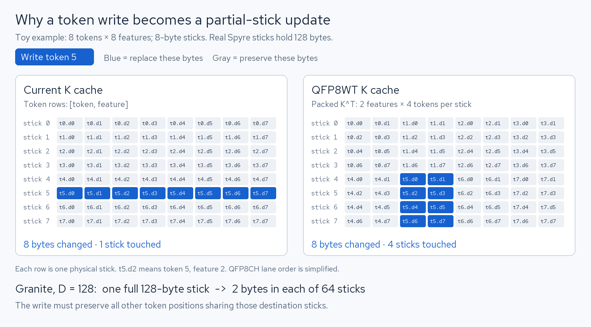

# FP8 QK attention: staged and native packed-cache paths

This branch preserves the working FP8 QK experiment and adds an executable
specification of a QFP8WT K cache. Both use dynamic per-query-row FP8 scaling,
a fixed per-tensor K scale, FP8 QK with DL16 output, and DL16 softmax/P×V.
They are experimental kernel/cache paths, not selectable vLLM attention backends.

## Code

| File | Purpose |
| --- | --- |
| [fp8_qk.py](../../../spyre_inference/v1/attention/ops/fp8_qk.py) | Original FP8 QK and dense attention primitives |
| [fp8_qk_cache.py](../../../spyre_inference/v1/attention/ops/fp8_qk_cache.py) | Allocation, staged reads, QFP8WT writes and direct reads |
| [Example](../../../examples/experimental/fp8_qk_cache.py) | Run either path and report the failing stage or numerical error |
| [Matrix runner](../../../examples/experimental/run_fp8_qk_cache_matrix.py) | Run single/four-sequence probes serially and generate an HTML report |
| [Logical writer tests](../../../tests/attention/test_fp8_qk_cache.py) | CPU checks for full pages, partial updates, saturation and preservation of neighbors |

The readers take one page per sequence, with query/output shape `[B, M, Hq, D]`.
Granite's four query groups per KV head are folded into the row dimension:
`[B, 8, 4*M, 128] @ [B, 8, 128, N]`. This avoids unsupported batch broadcasting
in `scaled_bmm`. The example uses 128-token pages, head size 128, and batches
of one or four sequences. Page IDs are reversed to test address indirection.

## 1. Working path: `staged`

K and V use the production head-major QFP8CH cache. The following workarounds
are part of the implementation, not assumptions left to the caller:

1. Use the existing quantized KV-store kernel, including materialization of
   strided inputs and a separate destination index tensor for each KV head.
2. Gather and expand K to DL16 in its own compiled invocation.
3. Transpose and repack the expanded values as QFP8WT in a second invocation.
   The values are still `K / k_scale`; compensation happens after QK.
4. Expand V and apply its fixed scale, keeping P×V in DL16.
5. Fold GQA groups, dynamically quantize each Q row, perform FP8 QK, compensate
   scales, and apply the mask and stable DL16 softmax.

Call `staged_fp8_attention` from Python. Wrapping the entire function in another
full-graph compile can erase the graph boundaries that make this path work.
These are on-device layout workarounds. CPU fallback warnings are errors in the
hardware example; there is no host round trip for attention or cache updates.

## 2. Native specification: `packed`

K is allocated as QFP8WT `[page, kv_head, D, token]`; V remains QFP8CH
`[page, kv_head, token, D]`. The K layout matches the existing `qfp8wt` producer:
the contraction dimension D is directly outside its 2×64 stick arrangement.
Merely tagging the old token-major bytes as QFP8WT would be incorrect.

`store_packed_kv_page` quantizes transposed fresh keys with `qfp8wt`, then uses
token-axis `index_copy_` into the selected page/head. This expresses the desired
full-page and incremental assignments as real operations. It assumes the
backend supports writing selected token positions in QFP8WT and preserves the
other bytes in each stick. There is no K expansion, read/merge/write emulation,
or fallback to the staged implementation on Spyre.

`packed_fp8_attention_kernel` gathers the already-transposed K page and feeds it
directly to FP8 QK. Only V expands to DL16. This independently requires gather
to preserve QFP8WT packing and the compiler's contraction-axis constraints.

The example separates the capabilities:

| Operation | What executes |
| --- | --- |
| `full` | Allocate the cache, write full pages using the selected writer, then attend |
| `read` | Seed correctly packed K with the existing on-device `qfp8wt` producer, then test the direct reader without the native writer |
| `update` | Seed history as above, then update one token at a time at offsets 63, 64 and 127 before attending |

`read` and `update` deliberately isolate the writer from allocation/packing;
their setup is not evidence that native cache writes work. Native errors are
not swallowed or marked as successful expected failures. Each invocation exits
nonzero on a compiler error, fallback, non-finite result or numerical mismatch,
and writes its last stage and error to JSON. The matrix continues through its
cases to collect evidence, then exits nonzero if any case failed.

The CPU tests validate the writer's logical assignment using ordinary FP8 CPU
storage. Since CPU `index_copy_` lacks an FP8 kernel, that CPU-only reference
copies the same FP8 bytes through uint8 views. It does not simulate Spyre's
physical packing and is not used as a Spyre fallback.

## Why incremental writes are difficult



[Interactive HTML: select a token and see its destinations](cache-layout.html).

For D=128, the old FP8 cache places one token's features together in one
128-byte stick. QFP8WT groups two features across 64 token positions per stick.
The same token therefore updates two bytes in each of 64 sticks; all other
positions must survive. The current row-scatter path cannot simply be reused
by changing the cache's shape or format tag. This is a compiler/kernel
capability gap, not an invalid PyTorch assignment or a requirement to use
per-channel K scales. A supported partial write, read/merge/write operation,
or a separate unfinished-tile policy would be needed for a production cache.

## Results from the original experiment

Tested upstream-main spyre-inference `89c4e2598411cd93bbb1f98cd54d1260634d64d6`
and torch-spyre `cbc79da3ab992fad10c80ef61ce6dae904882288`, with PyTorch
`2.13.0+cpu` and torch-spyre `0.6.0.dev355+head.gcbc79da3`.
Exact supplied lower-stack artifact hashes are in [provenance.json](provenance.json).

All eight arithmetic controls with correctly packed K passed: two-head and
Granite 32Q/8KV configurations, B1/B4, prefill/decode. Compiled artifacts emitted
the real `batchmatmulfp8` operation. Granite-shaped attention relative L2 error
against a float32 CPU reference with the same FP8 Q/K quantization:

| Batch | Prefill | Decode |
| --- | ---: | ---: |
| 1 | 1.215% | 1.162% |
| 4 | 1.148% | 1.295% |

The original staged production-cache prefill probes passed at B1/B4, with
1.373%/1.296% relative L2 error including dequantized FP8 V. All outputs were
finite. The acceptance limits were fixed at 4% for QK and 6% for attention;
they were not widened after testing.

The original **QFP8CH-cache direct-consumption** attempts failed for all four
B1/B4 prefill/decode cases. Those are distinct from this branch's **QFP8WT-cache
native writer/reader** probes. The older `native` label in historical scripts
means direct consumption of the old QFP8CH cache, not the new `packed` path.
Direct copy and a fused DL16 expansion/repacking graph also failed layout
compilation. Separating the conversion graphs produced the working staged path.

[Original HTML investigation](investigation.html) and [historical artifacts](history/)
retain the earlier evidence. Historical commands use `<spyre-inference>` and
`<experiment-artifacts>` as path placeholders; use the current commands below
to reproduce the maintained implementation.

## Branch validation

The maintained harness was run on the same stack recorded above. Four staged
hardware cases passed and six native cases failed with compiler errors.
[HTML results](results/index.html), [all commands](results/matrix.json), and
[CPU writer tests](results/cpu-tests.log) are included in this branch.

| Path / operation | Batch | Query tokens | Result |
| --- | ---: | ---: | --- |
| staged / full | 1 | 128 | Pass; attention relative L2 1.373% |
| packed / full | 1 | 128 | Compiler dtype-promotion error |
| packed / read | 1 | 128 | Compiler work-division error |
| packed / update | 1 | 1 | Compiler dtype-promotion error |
| staged / full | 4 | 128 | Pass; attention relative L2 1.296% |
| staged / update | 1 | 1 | Pass; attention relative L2 1.256% |
| staged / update | 4 | 1 | Pass; attention relative L2 1.454% |
| packed / full | 4 | 128 | Compiler dtype-promotion error |
| packed / read | 4 | 128 | Compiler work-division error |
| packed / update | 4 | 1 | Compiler dtype-promotion error |

The native full-page writer and first incremental write (offset 63) fail in
`torch_spyre/_inductor/split_multi_ops.py::_infer_output_dtype`:
`Promotion for Float8 Types is not supported, attempted to promote
Float8_e4m3fn and Long`. The incremental hardware probes therefore do not reach
slots 64/127; the CPU logical suite covers those positions and unchanged
neighbors. This failure occurs before native scatter layout support is proven.

With K seeded by the real on-device `qfp8wt` producer, the native reader fails
in `work_division.py::_cost_model_matmul_planner`: its search for a QFP8WT
input descriptor raises `StopIteration`. The allocated native layout matches
the actual producer's output layout for both batch sizes. The next backend
investigation is propagation of that weight arrangement through the gather
and into work division; the branch does not pretend this machinery is fixed.

The logical CPU writer suite passed all 12 cases. Ruff, the scoped `ty` check,
and Python syntax checks passed for the maintained source. The compiler errors
above are retained as experimental results, not counted as passing tests.


## Reproduce

Use the recorded main revision or a compatible newer torch-spyre build. The
repository's dependency pin predates this experiment; plain `uv run` or `uv sync`
can replace the locally installed torch-spyre build. Keep the recorded versions
when comparing results. This branch does not modify the dependency lockfiles.

On the development machine, source the canonical environment, then activate
the experiment venv and put this checkout first on `PYTHONPATH`:

```bash
source /mnt/devel/inductor_src/torch-spyre-docs/scripts/dev-env.sh
source .venv/bin/activate
export PYTHONPATH="$PWD:$SENTIENT_BASE_INSTALL_DIR/runtime/lib"
export SENLIB_INSTALL_DIR=/opt/ibm/spyre/senlib
export LD_LIBRARY_PATH="$SPYRE_COMMS_INSTALL_DIR/lib:$LIBAIUPTI_INSTALL_DIR/lib:$RUNTIME_INSTALL_DIR/lib:$DEEPTOOLS_INSTALL_DIR/lib:$SENLIB_INSTALL_DIR/lib"
export HF_HOME=/mnt/models/hf_cache
export SPYRE_DEVICES=0 AIU_WORLD_SIZE=1
export USE_SPYRE_PROFILER=0 SPYRE_KERNEL_CACHE=0
export OMP_NUM_THREADS=4 SPYRE_NUM_CPUS=8
export TORCHINDUCTOR_CACHE_DIR="$PWD/microbench_results/fp8-qk/compiler-cache"
```

Use lower-stack artifacts from `sentient/`; only senlib comes from
`/opt/ibm/spyre/senlib`. Do not run two Spyre workloads at once.
Run from the repository root:

```bash
python examples/experimental/fp8_qk_cache.py \
  --path staged --operation full --batch 4 --query-len 128 \
  --output microbench_results/fp8-qk/staged.json

python examples/experimental/fp8_qk_cache.py \
  --path packed --operation update --batch 1 --query-len 1 \
  --output microbench_results/fp8-qk/packed-update.json

python examples/experimental/run_fp8_qk_cache_matrix.py \
  --output-dir microbench_results/fp8-qk/matrix

python -m pytest --noconftest -o addopts= tests/attention/test_fp8_qk_cache.py -q
```

The example uses deterministic synthetic data and does not load model weights.
There has been no end-to-end Granite/AIOps run, quality evaluation or speedup
measurement using FP8 QK. The staged path retains K expansion and adds repacking;
passing it does not establish the proposed 1.3–1.5× matmul/prefill benefit.

Before integrating with production attention, implement/validate QFP8WT cache
updates and gathers, handle incomplete pages and prefix/chunked prefill, and
hoist Q quantization outside the online-softmax page loop. The current native
writer takes a Python page ID and specializes on it; a production writer needs
a scalable device-indexed page interface. These requirements are deliberately
visible in this executable specification.
